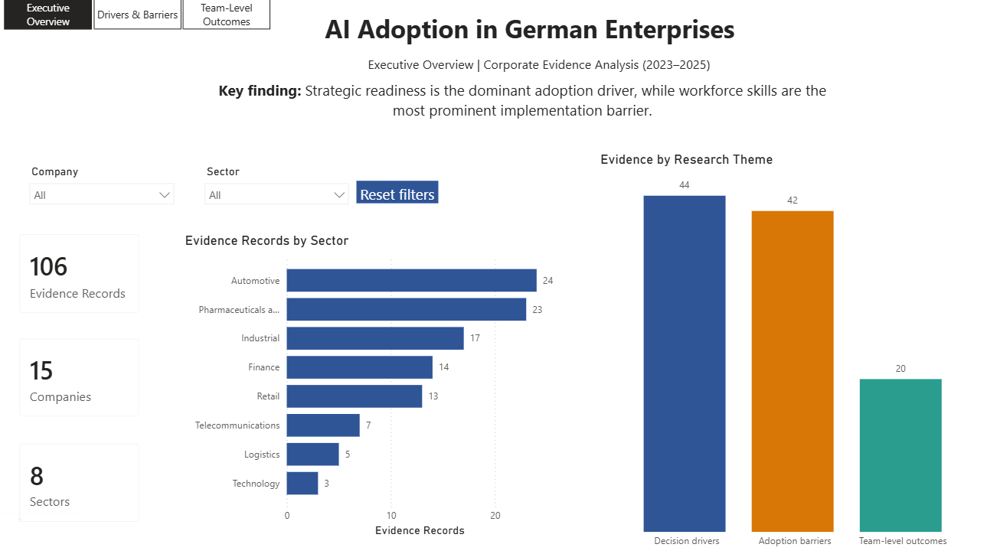
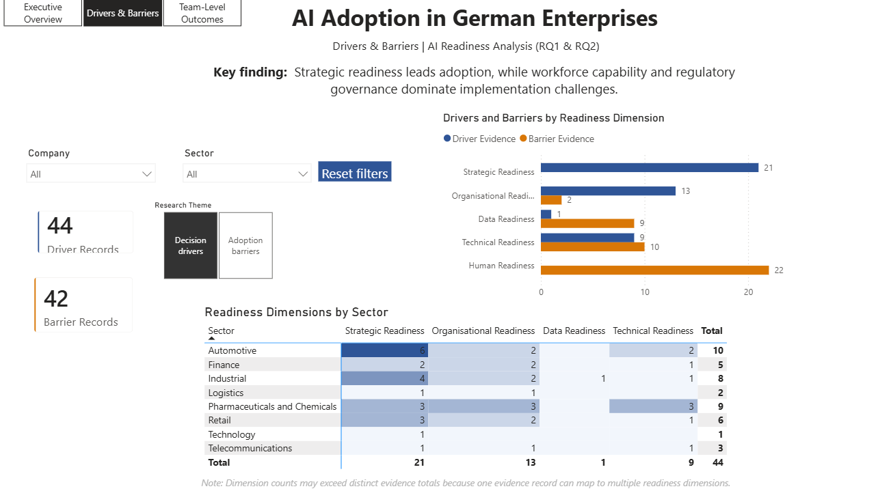
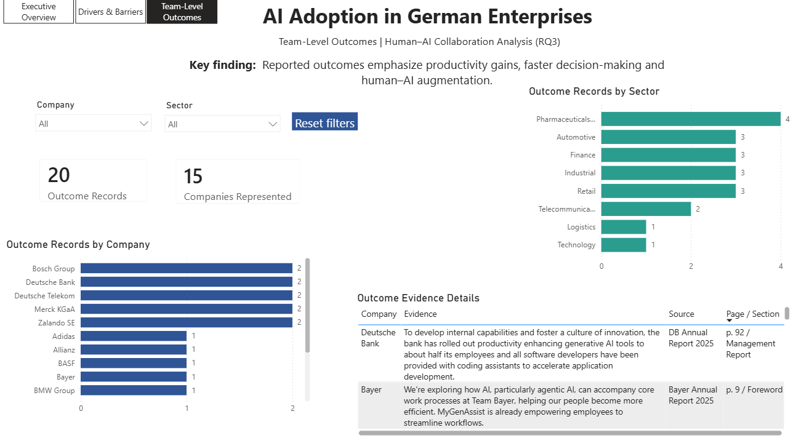

  
  

# AI Adoption in German Enterprises

**A Power BI analysis of how 15 large German companies adopt artificial intelligence: what drives it, what holds it back, and what it changes for teams.**

Based on my Bachelor thesis *"AI Tool Selection and Implementation in Project Management Teams"* at SRH University of Applied Sciences Heidelberg (thesis grade **1.0**).

  
  &nbsp;
  

## At a glance

| Scope | |
|---|---:|
| Companies analysed | 15 |
| Sectors | 8 |
| Evidence records | 106 |
| Period covered | 2023–2025 |
| Sources | Annual and corporate reports |

**Companies:** Adidas · Allianz · BASF · Bayer · BMW Group · Bosch Group · Continental · Deutsche Bank · Deutsche Post DHL · Deutsche Telekom · Merck KGaA · SAP · Siemens · Volkswagen Group · Zalando

## Key findings

1. **Strategy drives adoption.** Strategic readiness was the most frequently cited driver (21 mentions), well ahead of every other readiness dimension.
2. **People are the biggest barrier.** Workforce skills and human readiness were the most frequently cited obstacle (22 mentions), followed by technical readiness (10) and data readiness (9).
3. **Data is a blind spot.** Companies rarely describe data as a reason to adopt AI (1 mention), but often as a reason it is hard to implement (9 mentions).
4. **Teams report productivity, faster decisions and augmentation.** Reported team-level outcomes focus on productivity gains, quicker decision-making and AI supporting employees rather than replacing them.

## The three report pages

| Page | Question it answers |
|---|---|
| **Executive Overview** | How much evidence exists, by sector and by research theme? |
| **Drivers & Barriers** | Which readiness dimensions push AI adoption forward, and which slow it down? |
| **Team-Level Outcomes** | What changes do companies report for their teams after introducing AI? |

Every page can be filtered by company and sector, and the evidence tables link each data point to its source report and page number.

<b>See the other two pages</b>

 

## How the analysis was built

1. **Evidence collection:** Read the 2023–2025 annual and corporate reports of 15 German enterprises and extracted the relevant statements on AI adoption, with source and page reference.
2. **Coding:** Classified each statement by research question (drivers, barriers, team outcomes) and by readiness dimension (strategic, organisational, data, technical, human).
3. **Data preparation:** Structured the evidence in Excel and cleaned it with Power Query.
4. **Data model:** Built a star-schema model with company, sector, source, research-question and readiness-dimension tables.
5. **Measures and report:** Wrote DAX measures for the KPIs and built a three-page interactive report with slicers, cross-filtering and evidence detail tables.

**Tools:** Microsoft Power BI · Power Query · DAX · Excel · qualitative content analysis

## About the web version

The original report was built in **Microsoft Power BI**, and the `.pbix` file is included in this repository.

Publishing a Power BI report publicly requires a Microsoft work or school account with a Power BI licence, which wasn't available for this independent project. So that anyone can explore the report without signing in, the **interactive dashboard** linked above is a web replica of the Power BI report. It uses the same data and mirrors the same pages and filters.

## Files in this repository

| Folder | Contents |
|---|---|
| [`power-bi/`](power-bi/) | The original Power BI report (`.pbix`), which opens in Power BI Desktop |
| [`data/`](data/) | The coded evidence dataset (Excel) |
| [`screenshots/`](screenshots/) | Screenshots of the three report pages |

## Contact

**Susmeth Allan Sathees Kumar** · Mannheim, Germany

[LinkedIn](https://www.linkedin.com/in/susmethsathees) · [susmethallan@gmail.com](mailto:susmethallan@gmail.com)
